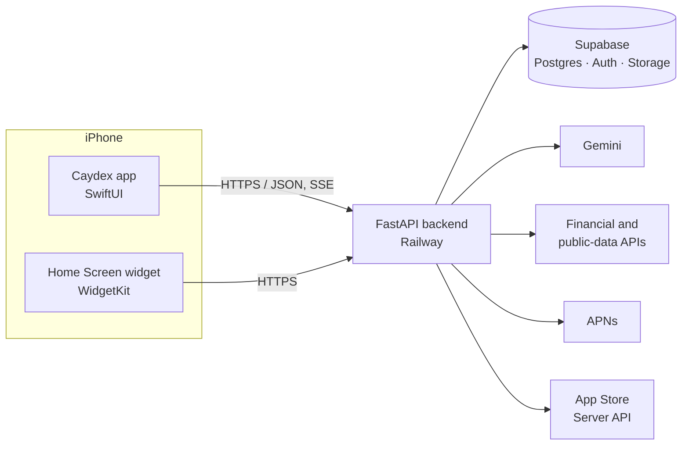

<div align="center">

# Caydex

**Research, not hype.**

AI-powered company research for iPhone: fundamentals, filings and news, explained in plain English.

<a href="https://apps.apple.com/us/app/caydex/id6759525689"></a>


[Website](https://caydexinvest.com) · [Support](https://caydexinvest.com/support) · [Privacy](https://caydexinvest.com/privacy) · [Terms](https://caydexinvest.com/terms)

</div>

---

## About

Caydex is a research tool for people who want to understand a company before forming an opinion about it. It reads the financial statements, filings and news, then explains what it found in plain English, so you can make your own decisions.

## Download

Caydex is available now on the App Store for iPhone.

1. On your iPhone, [open Caydex on the App Store](https://apps.apple.com/us/app/caydex/id6759525689), or open the App Store app and search for **Caydex**.
2. Tap **Get** to install. The app is free to download.
3. Open Caydex and create a free account with email, Sign in with Apple or Google.

**Requirements:** an iPhone running iOS 18.0 or later.

**Pricing:** a free account includes a monthly allowance of AI research credits. Pro and Max subscriptions and credit packs are optional in-app purchases.

## Features

| Feature | What it does |
|---|---|
| **Home** | A dashboard built around what you follow: market movers, your watchlist, and the day's activity across the companies and sectors you chose. |
| **Updates** | A running feed of what changed and why. When a stock makes an unusual move, Caydex looks for the catalyst (an earnings surprise, a filing, a news event) and explains it. |
| **Research** | Full company reports on fundamentals, growth, profitability, financial health, valuation, moat, and the bull and bear case. Each one is a point-in-time snapshot, exportable as PDF. |
| **Ask Cay AI** | A conversational assistant that answers questions about any company on screen and cites what it used. |
| **Tracking** | Institutional 13F holdings and congressional trading disclosures, with filing and disclosure dates shown. |
| **Wiser** | An education library of investing-book study guides, lessons and articles, all narrated with read-along highlighting. |

**Also in the app:** watchlists and portfolios with a diversification score · price alerts and earnings reminders · detail screens for stocks, ETFs, indices, crypto and commodities with interactive charts · a Home Screen widget · light and dark themes, Dynamic Type and VoiceOver support.

## Tech Stack

| Layer | Technology |
|---|---|
| **iOS app** | Swift, SwiftUI, Swift Charts, WidgetKit, App Intents, StoreKit 2, AVFoundation |
| **Backend** | Python 3.11, FastAPI, Pydantic v2, Uvicorn, HTTPX (async throughout) |
| **Database & storage** | Supabase: PostgreSQL with row-level security, Storage for media, versioned SQL migrations (no ORM) |
| **Authentication** | Supabase Auth: email and password, Sign in with Apple, Google Sign-In |
| **AI** | Google Gemini via the `google-genai` SDK: tool-calling research agent, structured generation, streaming chat |
| **Financial data** | Licensed financial data provider: fundamentals, estimates, filings and market data |
| **Public & alternative data** | CoinGecko, FRED, SEC EDGAR, FINRA, U.S. Census Bureau, openFDA, USPTO |
| **Web search** | Brave Search API (Ask Cay AI) |
| **Payments** | App Store in-app purchases: StoreKit 2 on device, App Store Server Library on the server |
| **Notifications** | Apple Push Notification service (HTTP/2) |
| **PDF reports** | Jinja2 and WeasyPrint |
| **Monitoring** | Sentry (iOS and backend) |
| **Hosting** | Railway (Docker) |

## Architecture



**Backend**

- **Layered:** endpoints → services → thin integration clients → Pydantic schemas. Business logic, caching and aggregation live in services; integrations only do HTTP in, data out.
- **Two-tier cache-aside:** an in-process memory tier backed by Supabase cache tables, with in-flight de-duplication so concurrent requests for the same data share one upstream call. Report caches are aligned to the market close.
- **Async-first:** independent upstream calls run in parallel with `asyncio.gather`, and the synchronous Supabase SDK runs off the event loop.
- **One error contract:** every error returns `{error_code, message, user_message, action}`, which the app maps to typed errors and actionable messages.
- **Bounded AI workload:** AI features require an account and are metered in credits. A global concurrency gate and per-company de-duplication keep report generation predictable under load.

**iOS**

- **Atomic Design:** Atoms → Molecules → Organisms → Screens.
- **MVVM:** one ViewModel per screen; shared state lives in an observable `AppState` injected through the environment.
- **One network entry point:** a Swift `actor` API client with typed endpoints and an explicit auth policy on every route.
- **Accessible theming:** adaptive colour tokens checked against WCAG contrast in both light and dark mode.

## AI Research Pipeline

A research report is produced in stages, so data gathering, scoring and writing stay separate:

1. **Collect:** fundamentals, estimates, filings and derived metrics are fetched in parallel, and deterministic scores are computed.
2. **Research:** a tool-calling agent investigates the company over several rounds.
3. **Structure:** a single structured pass produces the scoring and the report skeleton.
4. **Write:** word-capped writers fill each narrative section in parallel, and synthesis passes write the core thesis and the critical factors.

Every report is read through one of five analytical lenses: **The Quality Compounder**, **The Disruption Seeker**, **The Growth Hunter**, **The Activist Concentrator** and **The Deep Value Skeptic**. A report that degrades at any stage is tagged and never delivered as finished, and its credits are refunded.

## Repository Structure

```
.
├── backend/                    FastAPI service
│   ├── app/
│   │   ├── api/v1/endpoints/   HTTP routes
│   │   ├── services/           business logic, caching, AI agents
│   │   ├── integrations/       thin async clients for external APIs
│   │   ├── schemas/            Pydantic request and response models
│   │   └── templates/          PDF report templates
│   ├── database/migrations/    sequential, idempotent SQL migrations
│   ├── marketing/              media worker for the content pipeline
│   ├── scripts/                maintenance and data tooling
│   └── tests/                  pytest suite
├── frontend/ios/
│   ├── ios/                    the app: Core, Models, ViewModels, Views, Theme
│   ├── CaydexWidgets/          Home Screen widget extension
│   └── Shared/                 code shared by the app and the widget
└── documents/                  system design and product documentation
```

## Disclaimer

Caydex is an information and education tool. It is not a broker-dealer or an investment adviser, it holds no funds, and it executes no trades. Nothing in the app or in this repository is financial advice or a recommendation to buy or sell any security. AI-generated content is labelled as such in the app. Market and financial data may be delayed or contain errors.

## Contact

Hayden Phan · [haydenphancs@gmail.com](mailto:haydenphancs@gmail.com)

## License

© 2026 Hayden Phan. All rights reserved.
